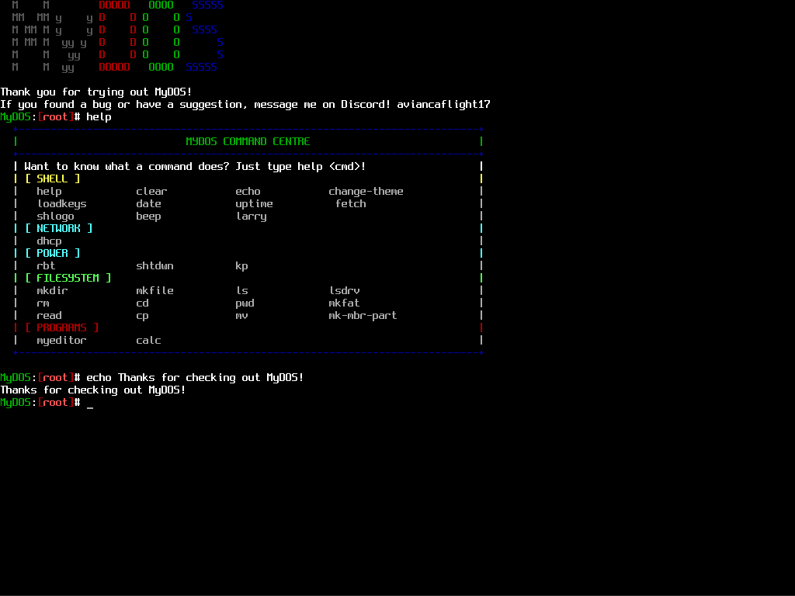

# MyDOS

MyDOS is my own 32-bit x86 hobby OS inspired by FreeDOS and the Linux kernel written in C and
assembly. It boots through Limine using the Multiboot 1 protocol. The hybrid ISO
supports both Legacy BIOS and UEFI! It runs great on QEMU, VirtualBox, VMware and 86Box.
I have not tested it on real hardware yet, so I doubt it boots :/ 



## Download

Prebuilt ISO releases are available on the
[Releases page](https://github.com/homu-sys/MyDOS/releases).

## Features

- Custom kernel 
- VGA text console and Multiboot framebuffer console, with a Spleen bitmap font 
- Keyboard-only shell with US, German, and French layouts
- FatFs filesystem support, with FAT32 formatting as the main option but theres FAT12/FAT16 too.
- ATA/IDE and AHCI SATA disk access
- DHCP and ICMP ping over Intel e1000 and Realtek RTL8139/8129 Ethernet controllers
- Built-in text editor and calculator
- Playable id-Software DOOM port (WAD file required)
- Live installer that copies MyDOS and Limine boot files to a disk (I am very proud of this one!)

## Boot options

- **Boot LiveCD** starts the regular MyDOS shell for you to try out.
- **Boot Installer** starts the installer shell with the installation package
  loaded from the ISO.

The console uses a framebuffer (128x48 text grid at 1024x768) if supported by the bootloader, otherwise it falls back to 80x25 VGA text mode. The font's BSD-2-Clause license is included in the ISO and system.

## Shell commands

Run `help` in MyDOS for the built-in command list, or `help <command>` for
command-specific help.

Shell:

- `help [command]`
- `clear [-dl|--draw-logo]`
- `echo [-c <color>|--color <color>] <text>`
- `set [PS1[=prompt]]` (customize the prompt with `\h`, `\u`, `\w`, `\W`, `\$`)
- `change-theme <default|matrix|ocean|sunset>`
- `loadkeys <us|de|fr|status>` (the main layout is German because thats my layout!)
- `dhcp [renew|status]`, `ping <ipv4-address> [count]`
- `date [-t|--time] [-d|--date] [-12|--12h]`
- `uptime [-p|--pretty] [-s|--seconds]`
- `fetch`, `shlogo`, `larry`, `beep`

Files and disks:

- `ls [path]`, `cd <path>`, `pwd`, `read <filename>`
- `mkfile <filename>`, `mkdir <dirname>`, `rm [-r|--recursive] <path>`
- `cp <source> <destination>`, `mv <source> <destination>`
- `lsdrv`
- `mkfat -f <12|16|32> <drive>:/`
- `myeditor`, `calc`, `doom [options] [wad]`

System:

- `rbt` reboots; `shtdwn` halts the CPU (a VM may not power off)
- `kp` deliberately triggers a kernel panic for testing

## Source layout

- `src/kernel/cmd/` - one file per shell command, plus the command table/dispatcher
- `src/kernel/net/` - networking core, DHCP, ARP/ICMP, PCI, and NIC drivers
- `src/kernel/shell/` - shell input/line editing and the `PS1` prompt renderer
- `src/kernel/drivers/` - VGA, keyboard, RTC, AHCI, and PC speaker drivers
- `src/programs/` - standalone programs such as the editor and calculator
- `src/programs/doom/` - id-Software DOOM 1.10 source plus the MyDOS platform port

## Installing to a disk

Choose **Boot Installer** from the Limine menu. The installer provides 
`help`, `clear`, `lsdrv`, `mkfat`,
`mydos-strap`, `rbt`, and `shtdwn`.

The target needs an MBR partition table with a FAT32 first partition starting
at or after LBA 63. The installer does not create partitions and does not
support GPT targets. Prepare the partition table before installing, then use:

```text
lsdrv
mkfat -f 32 0:/
mydos-strap 0:/
rbt
```

Replace `0:/` with the target drive shown by `lsdrv`. `mkfat` erases and formats
the selected drive/volume. Verify the drive number before running it and use a
disposable disk or back up its contents. `mydos-strap` requires FAT32; it copies
MyDOS and Limine files and installs BIOS boot code. After it succeeds, remove
the installer media and reboot.

## Build

Requirements:

- GCC with 32-bit compilation support, GNU `make`, NASM, and GNU binutils (`ld`)
- Limine command-line tool and its BIOS/UEFI boot files
- `xorriso`, `tar`, and `dd`
- QEMU (`qemu-system-i386`) to run the ISO; `qemu-img` for the optional disk
  image example below

Build the ISO file at `build/MyDOS.iso`:

```sh
make
```

The build looks up Limine's data directory with `limine --print-datadir`. If
needed, set `LIMINE_DATA_DIR` to the directory containing Limine's boot files:

```sh
make LIMINE_DATA_DIR=/path/to/limine/data
```

For most people, this might be:
```sh
make LIMINE_DATA_DIR=/usr/share/limine
```

## Run in QEMU

```sh
make run
```

`make run` attaches an Intel e1000 NIC with QEMU user-mode networking by
default. Override it with `QEMU_NET_ARGS`, for example
`QEMU_NET_ARGS='-nic user,model=rtl8139'`.

The regular LiveCD tries to mount an available disk. If it finds no recognized
filesystem, it asks whether to format the active disk as FAT32. Answering yes
erases/formats that disk, so use a disposable virtual disk when testing!

To attach a disposable AHCI disk image:

```sh
qemu-img create -f raw build/sata.img 128M
make run QEMU_STORAGE_ARGS='-device ich9-ahci,id=ahci -drive if=none,id=sata,file=build/sata.img,format=raw -device ide-hd,drive=sata,bus=ahci.0'
```

## DOOM

The ISO includes the DOOM engine, and the project includes official Freedoom
0.13.0 game data (`freedoom1.wad`, `freedoom2.wad`). Build the disk and boot:

```sh
make doom-disk
make run
```

In MyDOS, run `doom`. Freedoom Phase 1 is used by default; use
`doom -iwad 4:/FREEDOOM2.WAD` for Phase 2. `make run` attaches `doom.img` to a
QEMU AHCI controller so MyDOS uses its DMA driver instead of slow IDE PIO. The
image lives in the project root so `make clean` does not delete it. Override
with `DOOM_WAD=...`, `DOOM_DISK=...`, or `QEMU_STORAGE_ARGS=...`.

DOOM needs a framebuffer, so boot `build/MyDOS.iso` through Limine rather than
using direct `-kernel` boot. F10 opens the quit menu; F12 or Ctrl+Q returns to
the shell immediately.

## Roadmap

- Save DOOM settings and configuration back to the FAT disk
- Add sound and mouse support
- Improve DOOM startup and rendering performance
- Test on real hardware and improve hardware detection
- Add TCP, DNS, and HTTP support
- Add automated CI builds and ISO release artifacts

## Clean up the build files

```sh
make clean
```

## How to get the required tools:

For Ubuntu/Mint/Debian:

```sh
sudo apt update
sudo apt install build-essential gcc-multilib nasm xorriso tar coreutils qemu-system-x86 qemu-utils limine

```

For Arch/Arch-based distros:

```sh
sudo pacman -S base-devel nasm xorriso tar coreutils qemu-full limine

```

For Gentoo Linux:

```sh
sudo emerge --ask sys-devel/base-devel dev-lang/nasm sys-apps/xorriso app-arch/tar sys-apps/coreutils app-emulation/qemu sys-boot/limine
```
(I recommend you use the --getbinpkg flag to fetch the precompiled binaries, as some of these packages are quite large!)

For Windows:
Using [MSYS2](https://www.msys2.org/) (UCRT64 environment):

```sh
pacman -S base-devel mingw-w64-ucrt-x86_64-toolchain nasm mtools xorriso qemu

```

If you use a different OS, search it online!

## Contributors

- [homu-sys](https://github.com/homu-sys)
